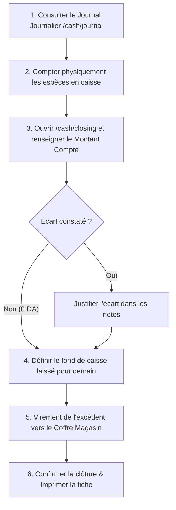

# Guide des Procédures Opérationnelles — Shop ERP

Ce document définit les protocoles et procédures standards d'exploitation (SOP) pour l'équipe du magasin : vendeurs, caissiers, magasiniers et responsables administratifs.

Il distingue clairement :
- 🔴 **Obligations Logicielles Strictes** : Actions requises par le système ERP sous peine de blocage ou d'incohérence comptable.
- 🟢 **Bonnes Pratiques Managériales** : Méthodes recommandées pour garantir la sécurité des fonds et la précision des stocks.

---

## Sommaire

1. [Cycle d'Ouverture Quotidienne (Matin)](#1-cycle-douverture-quotidienne-matin)
2. [Opérations Commerciales & Ventes en Cours de Journée](#2-opérations-commerciales--ventes-en-cours-de-journée)
3. [Réception de Marchandises & Gestion des Dépôts](#3-réception-de-marchandises--gestion-des-dépôts)
4. [Gestion Quotidienne des Fournisseurs](#4-gestion-quotidienne-des-fournisseurs)
5. [Dépenses & Décaissements Courants](#5-dépenses--décaissements-courants)
6. [Cycle de Clôture Quotidienne (Soir)](#6-cycle-de-clôture-quotidienne-soir)
7. [Procédures Hebdomadaires (Chaque Lundi / Fin de Semaine)](#7-procédures-hebdomadaires-chaque-lundi--fin-de-semaine)
8. [Procédures Mensuelles (Fin de Mois Comptable)](#8-procédures-mensuelles-fin-de-mois-comptable)

---

## 1. Cycle d'Ouverture Quotidienne (Matin)

### Procédure Étape par Étape :
1. **Démarrage du Système** :
   - Allumer le poste informatique principal de caisse.
   - Double-cliquer sur le fichier **`run.bat`** sur le bureau.
   - Attendre l'ouverture automatique du navigateur à l'adresse `http://localhost:3000`.

2. **Inspection du Tableau de Bord (`/`)** :
   - Vérifier les alertes opérationnelles (articles en rupture de stock, impayés clients majeurs).
   - Constater le statut de la caisse (actuellement *Fermée*).

3. **Comptage Physique du Fond de Caisse** (🟢 *Bonne Pratique*) :
   - Ouvrir physiquement le tiroir-caisse.
   - Compter les billets et pièces pour confirmer la présence du fond de roulement laissé la veille (ex: 20 000 DA).

4. **Ouverture Formelle de la Session** (🔴 *Obligation Logicielle*) :
   - Dans le menu latéral, aller dans **Trésorerie** > **Clôture Caisse** (`/cash/closing`).
   - Saisir le montant physique compté dans **Montant d'Ouverture**.
   - Cliquer sur **« Ouvrir la session de caisse »**.
   - Le statut passe au vert : toutes les futures ventes et dépenses en espèces de la journée seront rattachées à cette session.

---

## 2. Opérations Commerciales & Ventes en Cours de Journée

### 2.1 Enregistrement d'une Vente au Comptoir
1. Accéder au module **Ventes** (`/sales`) et cliquer sur **« Nouvelle Vente »**.
2. **Identification du client** :
   - Si le client souhaite une facture nominative, une livraison ou un paiement à crédit, le sélectionner dans la liste ou cliquer sur **« + Nouveau Client »**.
   - Si le client emporte directement son meuble et paie au comptant, conserver le client par défaut *Client Comptoir / Passager*.
3. **Sélection des articles & Dépôts de retrait** (🔴 *Obligation*) :
   - Pour chaque article ajouté, **sélectionner scrupuleusement le dépôt où le meuble est physiquement retiré** :
     - *Showroom* : Meuble d'exposition emporté immédiatement par le client.
     - *Garage Chaaban* ou *Garage Cheikh* : Meuble retiré du stock emballé en réserve pour livraison.
   - Le système bloque immédiatement la vente si le dépôt sélectionné ne dispose pas du stock suffisant.
4. **Validation & Règlement** :
   - Cliquer sur **« Valider la vente »**.
   - Saisir le montant payé en espèces ou par un autre moyen.
   - Si un reste dû subsiste, le système met automatiquement à jour la fiche du client.
5. **Impression du Document** :
   - Imprimer la facture de vente en double exemplaire (1 exemplaire pour le client, 1 exemplaire avec signature pour le magasin).

### 2.2 Utilisation d'un Acompte ou de la Cagnotte Épargne
- Si le client avait préalablement versé un acompte ou constitué une épargne, sélectionner le mode de paiement **Acompte** ou **Épargne Client**.
- Le système déduit le montant de la cagnotte sans exiger de nouvelle sortie ou entrée de trésorerie (Impact Trésorerie = 0 DA).

---

## 3. Réception de Marchandises & Gestion des Dépôts

### 3.1 Arrivée d'un Camion Fournisseur (Réception de Commande)
1. Aller dans **Achats & Fournisseurs** (`/purchases`).
2. Retrouver la commande correspondante et cliquer sur l'icône **« Réceptionner les articles »**.
3. **Contrôle physique des colis** (🟢 *Bonne Pratique*) :
   - Pointer chaque meuble déchargé (quantités, conformité des modèles et coloris).
   - Noter les éventuels cartons détériorés.
4. **Saisie de la Réception** (🔴 *Obligation Logicielle*) :
   - Saisir la quantité réellement reçue (totale ou partielle).
   - **Indiquer l'emplacement précis d'entreposage** (ex: *Garage Chaaban*).
   - Confirmer la réception pour que le stock devienne disponible à la vente.

### 3.2 Déplacement de Meubles vers le Showroom (Transfert Inter-Dépôts)
1. Quand un meuble doit être monté et exposé au magasin principal :
   - Aller dans **Produits & Stock** (`/products`).
   - Cliquer sur **« Transférer du stock »**.
   - Source : *Garage Chaaban* → Destination : *Showroom*.
   - Quantité : 1.
2. Valider le transfert. La fiche du meuble indique immédiatement sa nouvelle localisation.

---

## 4. Gestion Quotidienne des Fournisseurs

### 4.1 Règlement Ordinaire d'une Dette
- Lors du versement d'une somme convenue pour solder des commandes passées :
  - Aller sur **Fournisseurs** (`/suppliers`), cliquer sur **« Effectuer un règlement »**.
  - Choisir le compte (ex: *Coffre Magasin* ou *Caisse*).
  - La dette du fournisseur diminue, et la trésorerie est débitée.

### 4.2 Versement d'une Réserve ou Avance Hors-Dette
- Si vous confiez une somme d'argent à un fabricant sans facture immédiate :
  - Cliquer sur le bouton violet **« Donner de l'argent au fournisseur »**.
  - Sélectionner le compte débité et saisir le montant en DA.
  - La dette reste intacte, mais le magasin détient une créance imputable chez le fabricant.

### 4.3 Imputation sur Dette
- Lorsque des factures arrivent et que vous souhaitez absorber la dette à l'aide des fonds préalablement confiés :
  - Cliquer sur **« Imputer un versement »** (`FileCheck2`).
  - Choisir le versement disponible et renseigner le montant.
  - La dette est immédiatement allégée, sans aucun impact sur la trésorerie du jour (0 DA).

---

## 5. Dépenses & Décaissements Courants

Pour toute sortie d'argent destinée aux charges courantes (frais de déchargement, carburant camion, café/fournitures, réparations) :
1. Aller dans **Trésorerie** > **Charges** (`/cash/expenses`).
2. Cliquer sur **« Nouvelle Dépense »**.
3. Renseigner :
   - Le compte payeur (la *Caisse Principale* pour un paiement en liquide).
   - La catégorie exacte (ex: *Transport*, *Fournitures*, *Entretien*).
   - Le montant exact en DA.
   - Le bénéficiaire et le justificatif (ticket de caisse, reçu manuscrit).
4. Confirmer immédiatement : le solde théorique de la caisse est ajusté en temps réel.

---

## 6. Cycle de Clôture Quotidienne (Soir)

### Procédure Pas-à-Pas :
1. **Revue du Journal Journalier** (`/cash/journal`) :
   - Vérifier la concordance entre le journal informatique et les bons physiques de la journée (bons de vente, bons de dépense).
2. **Comptage Physique des Espèces** (🔴 *Obligation*) :
   - Sortir toutes les coupures et pièces du tiroir.
   - Réaliser le décompte exact.
3. **Enregistrement de la Clôture** (`/cash/closing`) :
   - Cliquer sur **« Clôturer la session de caisse »**.
   - Taper le montant réel compté dans le champ **Montant de Clôture (Compté)**.
   - Constater l'écart calculé par le système.
   - Saisir les explications si un écart existe (ex: *Erreur rendu monnaie 50 DA sur facture V-102*).
4. **Fixation du Report à Nouveau & Évacuation vers le Coffre** :
   - Conserver uniquement le fond de caisse habituel (ex: 20 000 DA) dans le tiroir.
   - Saisir ce montant dans **Montant Reporté (Laissé en caisse)**.
   - Transférer le surplus de la recette du jour vers le **Coffre Magasin** via un virement inter-comptes (`/cash/transfers`).
5. **Validation & Archivage** :
   - Valider la clôture.
   - Imprimer la **Fiche de Clôture Journalière** et l'agrafer avec les tickets de dépenses du jour dans le classeur de caisse.

---

## 7. Procédures Hebdomadaires (Chaque Lundi / Fin de Semaine)

1. **Revue des Stocks Critiques & Ruptures** (`/products` et `/reports`) :
   - Filtrer les articles sous le seuil d'alerte (*Stock Min*).
   - Établir la liste des réapprovisionnements prioritaires auprès des fabricants de meubles.
2. **Suivi des Créances Clients** (`/customers`) :
   - Trier les clients par solde débiteur décroissant.
   - Relancer par téléphone les clients dont les livraisons ont été effectuées et dont le reliquat est en attente.
3. **Rapprochement des Soldes des Coffres** (`/cash/accounts`) :
   - Vérifier physiquement le contenu du *Coffre Magasin* et du *Coffre Maison* avec les soldes affichés par l'ERP.
4. **Vérification de la Sauvegarde Hebdomadaire** :
   - Aller dans **Paramètres** > **Sauvegardes** (`/settings`).
   - S'assurer que les fichiers de sauvegarde automatiques sont générés régulièrement.

---

## 8. Procédures Mensuelles (Fin de Mois Comptable)

1. **Rapprochement Complet des Dettes Fournisseurs** (`/suppliers`) :
   - Générer le relevé de compte pour chaque fournisseur actif.
   - Comparer les états de facturation et solder les imputations en attente.
2. **Inventaire Physique Tournant** (`/documents` > *Fiche d'inventaire*) :
   - Imprimer la fiche d'inventaire vierge pour un des garages (ex: *Garage Cheikh*).
   - Réaliser le comptage physique carton par carton et saisir les ajustements nécessaires.
3. **Clôture Mensuelle Officielle** (`/closing/monthly`) (🔴 *Obligation*) :
   - Valider chaque ligne de la checklist comptable (Caisse, Banque, Stocks, Créances, Dettes).
   - Générer l'instantané de synthèse (*Snapshot*).
   - Cliquer sur **« Approuver et verrouiller le mois »**.
   - Le mois est désormais scellé, interdisant toute modification rétroactive imprudente.
4. **Création d'une Sauvegarde d'Archive Externe** (🟢 *Bonne Pratique Managériale*) :
   - Dans **Paramètres** > **Sauvegardes**, créer une sauvegarde manuelle.
   - Copier le fichier `.db` généré sur une clé USB ou un disque dur externe sécurisé, conservé hors du magasin.

