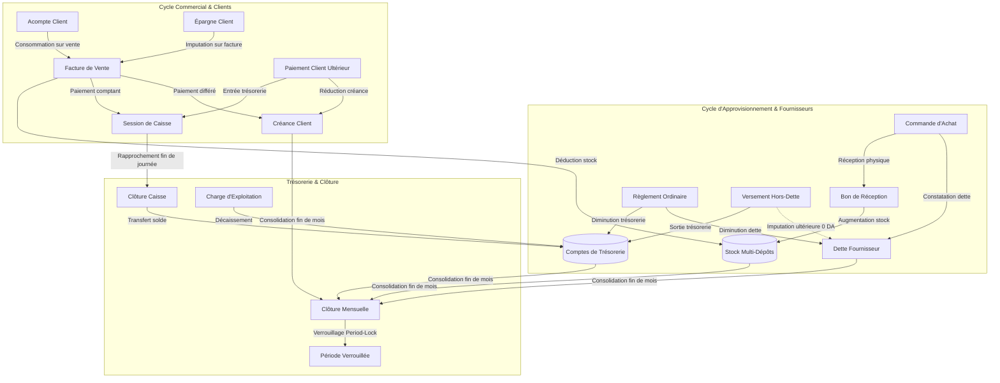

# Référentiel Technique & Métier — Shop ERP

Ce document constitue la référence technique et architecturale exhaustive de **Shop ERP**. Il détaille le modèle de données, les règles de gestion, les formules mathématiques de calcul, les actions serveur, les flux inter-modules et les contraintes d'intégrité du système.

---

## Sommaire

1. [Architecture Globale & Principes de Conception](#1-architecture-globale--principes-de-conception)
2. [Référentiel des Modules Applicatifs](#2-référentiel-des-modules-applicatifs)
   - [2.1 Module Tableau de Bord](#21-module-tableau-de-bord)
   - [2.2 Module Produits, Catégories & Multi-Dépôts](#22-module-produits-catégories--multi-dépôts)
   - [2.3 Module Ventes, Devis & Facturation](#23-module-ventes-devis--facturation)
   - [2.4 Module Achats & Réceptions de Marchandises](#24-module-achats--réceptions-de-marchandises)
   - [2.5 Module Clients & Créances](#25-module-clients--créances)
   - [2.6 Module Épargne & Avoirs Client](#26-module-épargne--avoirs-client)
   - [2.7 Module Fournisseurs, Dettes & Versements Supplémentaires](#27-module-fournisseurs-dettes--versements-supplémentaires)
   - [2.8 Module Trésorerie Multi-Comptes](#28-module-trésorerie-multi-comptes)
   - [2.9 Module Caisse Journalière & Sessions](#29-module-caisse-journalière--sessions)
   - [2.10 Module Charges & Dépenses d'Exploitation](#210-module-charges--dépenses-dexploitation)
   - [2.11 Module Clôture Mensuelle, Snapshots & Period-Lock](#211-module-clôture-mensuelle-snapshots--period-lock)
   - [2.12 Module Centre de Documents Unifiés & Impressions](#212-module-centre-de-documents-unifiés--impressions)
   - [2.13 Module Rapports & Analyses Statistiques](#213-module-rapports--analyses-statistiques)
   - [2.14 Module Paramètres & Sauvegardes SQLite](#214-module-paramètres--sauvegardes-sqlite)
3. [Flux de Travail Inter-Modules (Cross-Module Workflows)](#3-flux-de-travail-inter-modules-cross-module-workflows)
4. [Sécurité, Permissions & Limitations Connues](#4-sécurité-permissions--limitations-connues)

---

## 1. Architecture Globale & Principes de Conception

### 1.1 Modèle de Persistance et d'Accès aux Données
- **Moteur de base de données** : SQLite 3 exploité en local via `@libsql/client` (WASM / JavaScript pur) et connecté à Prisma ORM via `@prisma/adapter-libsql`.
- **Fichier de base de données** : `prisma/shop.db`.
- **Intégrité transactionnelle** : Toutes les opérations multi-tables (déduction de stock, règlements financiers, transferts inter-comptes, annulations) sont encapsulées dans des transactions interactives Prisma (`prisma.$transaction(async (tx) => { ... })`).
- **Verrouillage de concurrence SQLite** : SQLite étant un moteur à rédacteur unique (*single-writer*), la sérialisation des opérations concurrentes sur un même enregistrement (ex. un fournisseur ou un compte de trésorerie) est garantie par une mise à jour d'horodatage immédiate (`await tx.supplier.update({ where: { id }, data: { updatedAt: new Date() } })`), évitant les verrous concurrents sans nécessiter de syntaxe brute bloquante.

### 1.2 Immutabilité et Traçabilité (Append-Only)
Le système privilégie le paradigme *append-only* :
- Les mouvements physiques de stock (`StockMovement`) ne sont jamais mis à jour ni supprimés : une annulation génère un mouvement compensatoire inverse.
- Les annulations de paiements, de versements supplémentaires et d'imputations créent des écritures compensatoires (`isReversal: true`, `reversalOfId`) avec motif obligatoire et préservation du document d'origine.
- Les instantanés de clôture mensuelle (`MonthlyClosingSnapshot`) stockent des chaînes JSON figées représentant la vérité comptable à un instant $T$.

---

## 2. Référentiel des Modules Applicatifs

### 2.1 Module Tableau de Bord

- **Route** : `/`
- **Composant principal** : `src/app/DashboardClient.tsx`
- **Actions serveur** : `src/app/dashboard-actions.ts` (`getDashboardData`)
- **Modèles Prisma sollicités** : `Sales`, `Payment`, `Expense`, `CashSession`, `Product`, `Customer`

#### Formules & Règles Métier :
1. **Chiffre d'Affaires Facturé** :
   $$CA_{\text{facturé}} = \sum \text{Sales.totalAmount} \quad \text{pour } \text{status} = \text{"confirmed"}$$
2. **Encaissements Réels** :
   $$\text{Encaissements} = \sum \text{Payment.amount} \quad \text{pour les ventes} + \sum \text{CustomerAdvance.amount} + \sum \text{CustomerSavingsTransaction.amount (DEPOSIT)}$$
3. **Créances Clients Globales** :
   $$\text{Créances} = \sum (\text{totalAmount} - \text{paidAmount}) \quad \text{pour } \text{status} = \text{"confirmed"} \text{ et } \text{paymentStatus} \in \{\text{"unpaid"}, \text{"partial"}\}$$
4. **Variations en Pourcentage** :
   $$\Delta \% = \begin{cases} \frac{\text{Valeur Courante} - \text{Valeur Précédente}}{\text{Valeur Précédente}} \times 100 & \text{si } \text{Valeur Précédente} > 0 \\ \text{null} & \text{si } \text{Valeur Précédente} = 0 \end{cases}$$

---

### 2.2 Module Produits, Catégories & Multi-Dépôts

- **Route** : `/products`
- **Composant principal** : `src/app/products/ProductsModuleClient.tsx`
- **Actions serveur** : `src/app/products/actions.ts`
- **Modèles Prisma** : `Product`, `Category`, `Location`, `ProductStock`, `StockMovement`

#### Emplacements par Défaut :
Le système initialise automatiquement 4 dépôts physiques :
1. `SHOWROOM` (Showroom principal d'exposition - dépôt par défaut)
2. `GARAGE_CHAABAN` (Entrepôt Chaaban)
3. `GARAGE_CHEIKH` (Entrepôt Cheikh)
4. `GARAGE_3` (3ème Dépôt / Réserve secondaire)

#### Règles de Gestion :
1. **Génération séquentielle du SKU** :
   - Préfixe alphabétique issu de l'initiale de la catégorie (ex: `A` pour Armoire, `T` pour Table, `F` pour Fauteuil) ou `ART` par défaut.
   - Séquence numérique formatée sur 3 chiffres au minimum (`F001`, `F002`, ..., `F102`).
   - L'unicité est contrôlée sur **l'ensemble** des produits (actifs et archivés).
2. **Stock Multi-Dépôts & Interdiction du Stock Négatif** :
   $$\text{Stock Total Produit} = \sum_{i} \text{ProductStock.quantity (dépôt } i\text{)}$$
   Toute sortie ou vente vérifie obligatoirement :
   $$\text{Quantité demandée} \le \text{ProductStock.quantity (au dépôt spécifié)}$$
   En cas de quantité insuffisante, une exception bloquante est levée.
3. **Mouvements de Stock Typés** :
   `INITIAL` (Stock initial), `RECEIPT` (Entrée / Réception fournisseur / Restitution annulation), `ISSUE` (Sortie manuelle), `ADJUSTMENT` (Ajustement d'inventaire), `TRANSFER` (Transfert inter-dépôts), `SALE` (Sortie sur vente).

---

### 2.3 Module Ventes, Devis & Facturation

- **Route** : `/sales`
- **Composant principal** : `src/app/sales/SalesClient.tsx`
- **Actions serveur** : `src/app/sales/actions.ts`, `src/app/sales/advances-actions.ts`
- **Modèles Prisma** : `Sales`, `SaleItem`, `Payment`, `Customer`, `CustomerAdvance`, `CustomerAdvanceAllocation`, `CustomerSavingsTransaction`, `StockMovement`, `ProductStock`

#### Règles de Calcul & Statuts :
1. **Montant Total de la Vente** :
   $$\text{Sous-total Ligne} = \text{Quantité} \times \text{Prix Unitaire} - \text{Remise Ligne}$$
   $$\text{Subtotal} = \sum \text{Sous-total Lignes}$$
   $$\text{Total Vente} = \text{Subtotal} + (\text{includeDeliveryFee} ? \text{deliveryFee} : 0)$$
2. **Cycle de Vie d'une Vente** :
   - `draft` : Bon de commande / Devis proforma. Aucun stock déduit, aucun impact comptable.
   - `confirmed` : Vente validée. Déduction atomique du stock physique sur les dépôts spécifiés, mouvement `SALE` immuable, écriture de paiement immédiat ou constatation de dette client.
   - `cancelled` : Vente annulée. Réintégration immédiate des articles dans leurs dépôts d'origine via un mouvement `RECEIPT` (`RET-REF-SKU`), restitution des règlements, réouverture des acomptes clients et réajustement de la dette client.
3. **Statut de Paiement (`paymentStatus`)** :
   - `unpaid` : $\text{paidAmount} = 0$
   - `partial` : $0 < \text{paidAmount} < \text{totalAmount}$
   - `paid` : $\text{paidAmount} \ge \text{totalAmount}$

---

### 2.4 Module Achats & Réceptions de Marchandises

- **Route** : `/purchases`
- **Composant principal** : `src/app/purchases/PurchasesClient.tsx`
- **Actions serveur** : `src/app/purchases/actions.ts`
- **Modèles Prisma** : `Purchase`, `PurchaseItem`, `PurchaseReceipt`, `PurchaseReceiptItem`, `Payment`, `Supplier`, `StockMovement`, `ProductStock`

#### Règles de Gestion :
1. **Commandes et Réceptions Séparées** :
   Une commande d'achat (`Purchase`) enregistre les quantités négociées et le coût d'achat convenu. Le stock physique n'augmente que lors de l'enregistrement effectif d'un **Bon de Réception** (`PurchaseReceipt`).
2. **Réceptions Partielles** :
   $$\text{receivedQuantity (ligne)} \le \text{quantity (commandée)}$$
   - Si $\sum \text{receivedQuantity} = 0$ : `receiptStatus = "pending"`
   - Si $0 < \sum \text{receivedQuantity} < \text{totalQuantity}$ : `receiptStatus = "partial"`
   - Si $\sum \text{receivedQuantity} = \text{totalQuantity}$ : `receiptStatus = "received"`
3. **Mise à Jour du Coût de Revient** :
   Chaque réception physique met à jour le champ `Product.costPrice` avec le dernier prix d'achat unitaire saisi.

---

### 2.5 Module Clients & Créances

- **Route** : `/customers`
- **Composant principal** : `src/app/customers/CustomersClient.tsx`
- **Actions serveur** : `src/app/customers/actions.ts`
- **Modèles Prisma** : `Customer`, `Sales`, `Payment`, `CustomerAdvance`, `CustomerSavingsAccount`

#### Calcul de la Créance Client :
Pour chaque client, le solde restant dû est calculé dynamiquement :
$$\text{Dette Client} = \sum (\text{totalAmount} - \text{paidAmount}) \quad \text{sur toutes les ventes } \text{confirmed}$$
$$\text{Acomptes Disponibles} = \sum (\text{amount} - \text{allocatedAmount} - \text{refundedAmount}) \quad \text{sur } \text{customer\_advances}$$
$$\text{Solde Épargne} = \text{CustomerSavingsAccount.balance}$$

---

### 2.6 Module Épargne & Avoirs Client

- **Route** : `/savings`
- **Composant principal** : `src/app/savings/SavingsClient.tsx`
- **Actions serveur** : `src/app/savings/actions.ts`
- **Modèles Prisma** : `CustomerSavingsAccount`, `CustomerSavingsTransaction`, `TreasuryAccount`, `CashSession`, `Sales`

#### Règles Métier :
- **Dépôt libre (`DEPOSIT`)** : Le client dépose une somme sans acheter immédiatement d'article.
  - Impact trésorerie : **Entrée d'argent réelle** sur le compte de trésorerie sélectionné (Caisse, Coffre, etc.).
  - Impact client : `CustomerSavingsAccount.balance` augmente du montant versé.
- **Utilisation sur vente (`USAGE`)** : La cagnotte est utilisée pour régler partiellement ou totalement une facture de vente.
  - Impact trésorerie : **0 DA** (l'argent physique est déjà présent en caisse).
  - Impact vente : $\text{paidAmount}$ augmente, $\text{paymentStatus}$ est actualisé.
  - Impact client : `CustomerSavingsAccount.balance` diminue du montant utilisé.
- **Remboursement au client (`REFUND`)** :
  - Condition : $\text{Montant remboursé} \le \text{Solde disponible}$
  - Impact trésorerie : **Sortie d'argent réelle** du compte de trésorerie sélectionné.
  - Impact client : `CustomerSavingsAccount.balance` diminue.

---

### 2.7 Module Fournisseurs, Dettes & Versements Supplémentaires

- **Route** : `/suppliers`
- **Composants** : `SuppliersClient.tsx`, `SupplierAdditionalPaymentModal.tsx`, `SupplierAllocationModal.tsx`, `SupplierAllocationSection.tsx`
- **Actions serveur** :
  - `src/app/suppliers/actions.ts`
  - `src/app/suppliers/additional-payment-actions.ts`
  - `src/app/suppliers/allocation-actions.ts`
- **Modèles Prisma** : `Supplier`, `Purchase`, `Payment`, `SupplierDebt`, `SupplierAdditionalPayment`, `SupplierAdditionalPaymentAllocation`, `TreasuryAccount`

#### Architecture Financière à 3 Soldes Indépendants :

```
┌─────────────────────────────────────────────────────────────────────────────┐
│                       COMPTE FOURNISSEUR INDÉPENDANT                        │
├──────────────────────────────┬──────────────────────────────┬───────────────┤
│    1. DETTE FOURNISSEUR      │  2. VERSEMENT SUPPLÉMENTAIRE │ 3. DISPONIBLE │
│       (Reste Dû Net)         │          HORS-DETTE          │  À IMPUTER    │
└──────────────────────────────┴──────────────────────────────┴───────────────┘
```

1. **Calcul de la Dette Fournisseur Nette** :
   $$\text{Total Dû} = \sum \text{SupplierDebt (dette initiale)} + \sum \text{Purchase.totalAmount}$$
   $$\text{Total Réglé} = \sum \text{Payment.amount (règlements ordinaires)}$$
   $$\text{Total Imputé} = \sum \text{SupplierAdditionalPaymentAllocation.amount (imputations actives)}$$
   $$\text{Dette Fournisseur Nette} = \text{Total Dû} - \text{Total Réglé} - \text{Total Imputé}$$

2. **Versement Supplémentaire Hors-Dette (`SupplierAdditionalPayment`)** :
   - L'entreprise donne de l'argent physique au fournisseur sans régler une facture précise.
   - **Impact Trésorerie** : Déduction immédiate sur le compte de trésorerie choisi (Caisse, Coffres, Banque).
   - **Impact Dette** : **STRICTEMENT 0 DA**. La dette reste identique.

3. **Imputation d'un Versement sur la Dette (`SupplierAdditionalPaymentAllocation`)** :
   - Opération purement comptable interne réaffectant un versement existant pour solder la dette.
   - **Plafond strict** :
     $$\text{Montant imputé} \le \min(\text{Solde restant du versement}, \text{Dette fournisseur en cours})$$
   - **Impact Trésorerie** : **STRICTEMENT 0 DA**. Aucun mouvement de caisse ni de banque.
   - **Impact Dette** : Diminution de la dette fournisseur nette.

4. **Annulation Compensatoire & Sécurité** :
   - Une imputation peut être annulée de manière compensatoire (`isReversal: true`, `status: "completed"`), ce qui restaure la dette et le solde imputable du versement source.
   - **Verrou de dépendance** : Un versement supplémentaire d'origine ne peut pas être annulé tant qu'il possède des imputations actives.

---

### 2.8 Module Trésorerie Multi-Comptes

- **Route** : `/cash` (et `/cash/accounts`, `/cash/transfers`, `/cash/deposits`, `/cash/withdrawals`)
- **Composants** : `GlobalSituationClient.tsx`, `AccountsClient.tsx`, `TransfersClient.tsx`, etc.
- **Actions serveur** : `src/app/cash/treasury-actions.ts`
- **Modèles Prisma** : `TreasuryAccount`, `TreasuryTransfer`, `Payment`, `Expense`, `CustomerAdvance`, `CashSession`

#### Typologie des Comptes :
1. `cash` (Caisse physique de vente - rattachée à la session active)
2. `safe` (Coffre-fort magasin, Coffre-fort maison)
3. `bank` (Compte bancaire / CCP)
4. `other` (Autre compte financier)

#### Calcul du Solde d'un Compte :
Pour tout compte non lié à une session de caisse :
$$\text{Solde} = \text{openingBalance} + \text{Virements Reçus} - \text{Virements Émis} + \text{Paiements Ventes} + \text{Acomptes Reçus} + \text{Encaissements Exceptionnels} + \text{Dépôts Épargne} - \text{Paiements Fournisseurs} - \text{Dépenses} - \text{Remboursements Épargne} - \text{Versements Fournisseur Hors-Dette} + \text{Annulations de Versements}$$

Pour le compte de caisse (`type = "cash"` ou `isDefault = true`), le solde en cours de journée est indexé sur :
$$\text{Solde Caisse} = \text{openingAmount (session)} + \text{Flux Entrants de Session} - \text{Flux Sortants de Session}$$

---

### 2.9 Module Caisse Journalière & Sessions

- **Route** : `/cash/journal`, `/cash/closing`
- **Composants** : `DailyJournalClient.tsx`, `ClosingClient.tsx`
- **Actions serveur** : `src/app/cash/actions.ts`
- **Modèles Prisma** : `CashSession`, `Payment`, `Expense`, `TreasuryTransfer`, `CustomerAdvance`

#### Procédure de Session :
1. **Ouverture de session** : Enregistrement du montant de fond de caisse initial (`openingAmount`).
2. **En cours de journée** : Les encaissements et décaissements en espèces sont automatiquement associés au `sessionId` ouvert.
3. **Calcul Théorique de Fin de Journée** :
   $$\text{Théorique} = \text{openingAmount} + \text{Total Cash In} - \text{Total Cash Out}$$
4. **Comptage Physique & Écart de Caisse** :
   $$\text{Écart} = \text{closingAmount (compté)} - \text{Théorique}$$
   - Si $\text{Écart} = 0$ : Caisse parfaitement équilibrée.
   - Si $\text{Écart} > 0$ : Excédent de caisse constaté.
   - Si $\text{Écart} < 0$ : Déficit / Manquant de caisse constaté.
5. **Report à Nouveau** : Le montant conservé en caisse pour le lendemain (`retainedAmount`) devient le fond de caisse de la session suivante.

---

### 2.10 Module Charges & Dépenses d'Exploitation

- **Route** : `/cash/expenses`
- **Composant** : `ExpensesClient.tsx`
- **Actions serveur** : `src/app/cash/actions.ts`
- **Modèles Prisma** : `Expense`, `TreasuryAccount`, `CashSession`

#### Catégories Normalisées :
- `transport` (Transport & livraisons)
- `utilities` (Électricité, gaz, eau, internet)
- `rent` (Loyer & charges locatives)
- `maintenance` (Entretien & réparations)
- `supplies` (Fournitures, emballages, outillage)
- `salary` (Salaires & primes du personnel)
- `other` (Autres charges diverses)
- `capital` (Apport de capital / injection)
- `misc_income` (Encaissement exceptionnel)

---

### 2.11 Module Clôture Mensuelle, Snapshots & Period-Lock

- **Route** : `/closing/monthly`
- **Composants** : `MonthlyClosingClient.tsx`, `ChecklistSection.tsx`, `SnapshotManager.tsx`
- **Actions serveur** : `src/app/closing/monthly/actions.ts`, `src/lib/period-lock.ts`
- **Modèles Prisma** : `MonthlyClosingPeriod`, `MonthlyClosingSnapshot`, `MonthlyClosingChecklist`, `MonthlyClosingAuditLog`

#### Mécanisme de Verrouillage Périodique (`Period-Lock`) :
- Dès qu'un mois est approuvé et verrouillé (`isLocked = true` ou `status = "FINAL"`), la fonction utilitaire `assertPeriodNotLocked(date)` bloque impérativement toute tentative de :
  - Création, modification ou annulation de vente datée du mois clôturé.
  - Création, modification ou annulation d'achat ou de réception.
  - Mouvement de stock, transfert ou dépense.
  - Règlement client ou fournisseur.
- **Réouverture Exceptionnelle** :
  - Nécessite la saisie obligatoire d'un motif explicite d'au moins 10 caractères.
  - Enregistre une trace immuable dans `MonthlyClosingAuditLog` avec horodatage, identité de l'opérateur et justification.

---

### 2.12 Module Centre de Documents Unifiés & Impressions

- **Route** : `/documents`
- **Composant** : `DocumentsClient.tsx`
- **Actions serveur** : `src/app/documents/actions.ts`, `src/lib/pdf/inventoryPdf.ts`, `src/lib/pdf/invoicePdf.ts`
- **Types de documents pris en charge** :
  - Factures de vente (`invoice`) & Devis proforma (`quote`)
  - Bons de commande fournisseur (`purchase`) & Bons de réception (`receipt`)
  - Reçus de paiement client (`payment_client`) & Bons de paiement fournisseur (`payment_supplier`)
  - Fiches de clôture de caisse journalière (`cash_session`)
  - Pièces justificatives de charges (`expense`) & Bons de virement inter-comptes (`transfer`)
  - Fiches d'inventaire physique par dépôt ou consolidées (`inventory_sheet`)
  - Relevés de compte tiers (`account_statement`)

---

### 2.13 Module Rapports & Analyses Statistiques

- **Route** : `/reports`
- **Composant** : `ReportsClient.tsx`
- **Actions serveur** : `src/app/reports/actions.ts`

#### Formules de Calcul :
1. **Taux de Recouvrement Client** :
   $$\text{Taux Recouvrement} = \frac{\text{Encaissements de la période}}{\text{Chiffre d'Affaires Facturé TTC}} \times 100$$
2. **Marge Brute Estimée & Transparence de Couverture** :
   Certains articles peuvent avoir été vendus sans coût d'achat renseigné ($costPrice = null$). Le module applique une formule transparente :
   $$\text{Marge Brute Estimée} = \sum_{\text{articles avec coût}} (\text{Prix Vente} - \text{Coût Achat})$$
   $$\text{Taux de Couverture des Coûts} = \frac{\text{CA des articles ayant un coût connu}}{\text{CA Total Facturé}} \times 100$$
3. **Valorisation des Stocks par Dépôt** :
   $$\text{Valeur au Coût (Dépôt } i\text{)} = \sum_{p} (\text{Quantité}_{p, i} \times \text{Coût Unitaire}_p)$$
   $$\text{Valeur au Prix de Vente (Dépôt } i\text{)} = \sum_{p} (\text{Quantité}_{p, i} \times \text{Prix Vente}_p)$$

---

### 2.14 Module Paramètres & Sauvegardes SQLite

- **Route** : `/settings`
- **Composant** : `SettingsClient.tsx`
- **Actions serveur** : `src/app/settings/actions.ts`, `scripts/backup.mjs`
- **Modèle Prisma** : `ShopSettings`

#### Fonctionnalités d'Administration :
- Édition de l'identité commerciale, adresse, numéros de téléphone et mentions de pied de page des factures.
- Téléversement et suppression du logo d'entreprise (intégré automatiquement dans les en-têtes de documents imprimables et PDF).
- Sauvegarde transactionnelle non-bloquante via `VACUUM INTO` avec purge rotative des archives (conservation par défaut des 30 fichiers les plus récents).
- Restauration sécurisée avec confirmation par saisie textuelle intégrale du nom du fichier et création préalable d'un fichier de secours `pre_restore_*.db`.

---

## 3. Flux de Travail Inter-Modules (Cross-Module Workflows)



### 3.1 Vente → Facture → Encaissement → Trésorerie
1. L'utilisateur crée une vente avec client passager ou enregistré.
2. La validation vérifie la disponibilité du stock dans le dépôt choisi.
3. Le stock est décrémenté, un mouvement `SALE` est créé.
4. Si un règlement immédiat est saisi :
   - S'il s'agit d'espèces, il est imputé à la `CashSession` ouverte.
   - S'il s'agit d'un autre compte (virement, chèque, coffre), le compte correspondant est crédité.
5. Si la vente n'est pas soldée, le solde restant alimente la créance du client.

### 3.2 Commande d'Achat → Réception → Dette Fournisseur
1. Enregistrement d'une commande d'achat `Purchase` (`status = "ordered"`). La dette fournisseur globale intègre le montant total de la commande.
2. Enregistrement d'un ou plusieurs bons de réception `PurchaseReceipt`.
3. Chaque réception incrémente `ProductStock` au dépôt sélectionné et enregistre un mouvement `RECEIPT`.
4. Les paiements effectués au fournisseur réduisent sa dette globale et déduisent les montants des comptes de trésorerie sources.

### 3.3 Versement Fournisseur Hors-Dette → Imputation sur Dette
1. Un montant est remis au fournisseur sans attribution à une facture (`createSupplierAdditionalPaymentAction`).
2. Le compte de trésorerie est débité immédiatement. La dette fournisseur reste rigoureusement inchangée.
3. Ultérieurement, l'utilisateur impute tout ou partie de ce versement sur la dette du fournisseur (`createSupplierAdditionalPaymentAllocationAction`).
4. **L'imputation impacte la trésorerie pour STRICTEMENT 0 DA** : la dette fournisseur est diminuée, et le solde disponible du versement est réduit à due concurrence.

### 3.4 Clôture Journalière → Transfert → Trésorerie Globale
1. En fin de journée, l'utilisateur ferme la session de caisse en comptant les espèces physiques.
2. Le système calcule l'écart par rapport au solde théorique.
3. L'utilisateur décide du montant à laisser en fond de caisse (`retainedAmount`) et du montant transféré vers un coffre ou une banque (`TreasuryTransfer`).
4. Les soldes de tous les comptes sont mis à jour de manière cohérente.

---

## 4. Sécurité, Permissions & Limitations Connues

### 4.1 Modèle d'Utilisateur & Permissions
- L'application est mono-utilisateur / monoposte en réseau local (*single-tenant on-premise*).
- Il n'existe pas de table `User` ni de formulaire d'authentification par mot de passe. Toutes les opérations sont consignées sous l'entité par défaut `Opérateur` ou l'initiale de session `A` (Administrateur).

### 4.2 Verrouillage de Clôture Périodique
- La sécurité comptable repose sur le moteur `period-lock.ts`. Tout mois ayant le statut `FINAL` ou `isLocked = true` interdit formellement les écritures passées pour préserver la sincérité du bilan d'exploitation.

### 4.3 Limitations Connues
1. **Concurrence Réseau** : Bien que SQLite supporte l'accès concurrent en lecture, les écritures simultanées massives à travers un partage réseau Windows peuvent entraîner des verrous temporaires (*database locked*). Le moteur Prisma interactive transaction et les retries intégrés minimisent ce risque.
2. **Gestion des Devises** : Le système est optimisé pour le Dinar Algérien (DA). Les calculs sont arrondis au centime le plus proche selon les règles bancaires standard.

